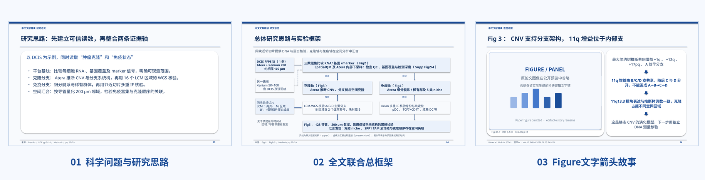
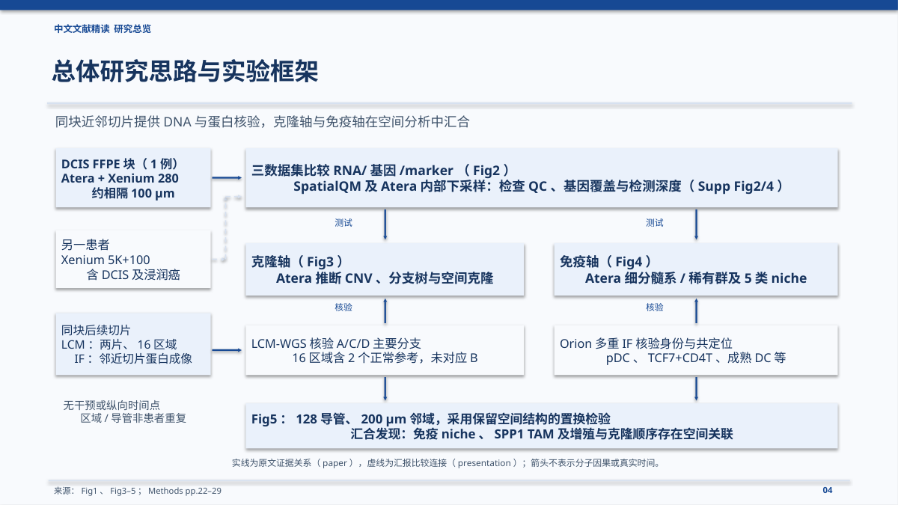
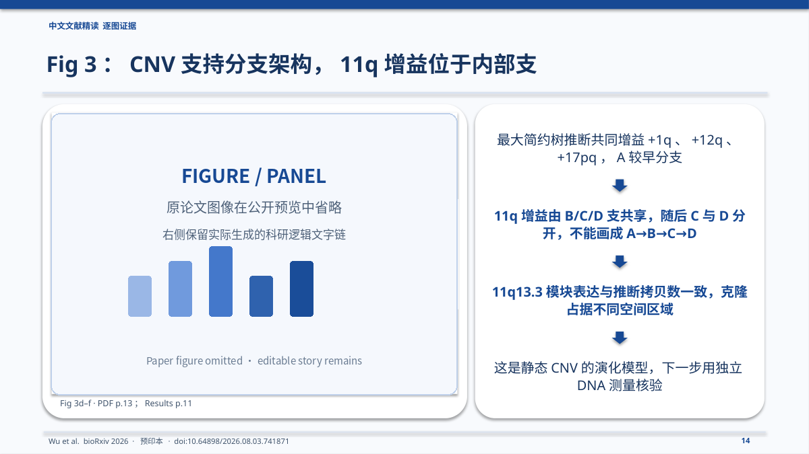

<div align="center">


# Paper Figure Story

**论文科研逻辑重构 · 全文实验路线图 · 逐 Figure 科研故事 · 可编辑学术 PPT**

*A Codex Skill for turning scientific papers into evidence-grounded research stories and editable academic presentations.*

**Version 5.1** · `quick` / `balanced` / `full` · 默认配色 `#174994` · 支持自定义 PPT 模板

**使用许可：仅限个人非商业使用（Personal Non-Commercial Use License v1.0），禁止商业用途及组织化部署。** 本项目为 source-available（源码公开可查看），**不是 OSI 定义的开源软件**。

[功能介绍](#核心功能) · [Atera 实际案例](#实际案例atera-全转录组空间分析) · [快速安装](#快速安装) · [使用方法](#使用方法) · [科研准确性与版权](#科研准确性与版权)

</div>

---

## 项目简介

阅读一篇科研论文，难点往往不是逐段理解结果，而是回答：**为什么开展这个实验？用了什么样本与对照？这个结果解决了什么问题，又为什么引出下一个实验？**

**Paper Figure Story** 面向科研组会、文献汇报和学术交流，将论文的正文、Methods、Figure legends 与关键补充证据组织成可讲述的科研故事，自动生成中文、可编辑的 PPTX。它不是论文摘要生成器，也不只是把 Figure 排进幻灯片。



## 核心功能

| 功能 | 输出内容 | 设计原则 |
| --- | --- | --- |
| **科学问题重构** | 已知基础、研究缺口、论文目标 | 从“为什么研究”而非技术名称开始 |
| **实验设计提取** | 对象、样本、处理、对照、时间点、方法及读数 | 每个结论可追溯至原文 |
| **全文联合总框架** | 研究思路 + 分组设计 + 并行实验 + 验证 + 总发现 | **模块化、分支与汇合**，不强行画成单线流程 |
| **逐 Figure 故事** | 原始图像 + 旁侧文字箭头链 | “为什么做 → 怎么做 → 发现什么 → 继续追问什么” |
| **可编辑 PPTX** | 标题、框、箭头与讲述文字可编辑 | 用户模板优先；默认16:9、`#174994`、无Logo |
| **证据检查** | 图号、方法、数字、样本及推断边界核对 | 不将统计关联、空间共定位冒充因果证明 |

### 1. 全文研究思路与实验路线在同一页

这张页面回答**整篇论文如何展开**，而不是某一张 Figure 的实验故事。它把研究对象、样本来源、技术任务、独立验证和最终分析关联放进同一框架。



### 2. 每张 Figure：图像是证据，文字链才是讲述核心

结果页提炼具体研究问题、实验方法、关键观察和下一步问题，并使用可编辑的箭头组织逻辑。若同一个科研问题跨多个 panel，可合并；若存在并行证据，不人为制造因果顺序。



> 图示为实际生成PPT的布局预览。公开预览中已移除第三方论文Figure，右侧研究逻辑文字链保留。

---

## 实际案例：Atera 全转录组空间分析

**论文**：Wu et al., *Resolving the immune response across clonal cancer evolution in situ with Atera whole transcriptome profiling*, bioRxiv (2026), [DOI: 10.64898/2026.08.03.741871](https://doi.org/10.64898/2026.08.03.741871)。该研究为预印本。

我们使用这篇论文测试了深度讲述工作流：从平台测量能力出发，分别展开**肿瘤克隆轴**（空间转录组 CNV 推断、LCM-WGS 独立核验）和**免疫状态轴**（稀有细胞识别、多重IF验证），最终汇合到肿瘤克隆与免疫微环境的空间关联分析。

- **原始测试成果**：30页、16:9的中文学术PPT（v5深度工作流案例）。
- **公开演示版本**：保留30页页面结构、科研文字逻辑和可编辑对象；为避免未经授权再分发预印本Figure，移除了37处嵌入的原论文图片。
- **关于 `full`**：v5.1中的 `full` 延续深度精读理念，但不保证与这次案例页数完全相同。

**[下载 Atera 30页公开演示版 PPTX](examples/atera/atera-research-story-demo-30-slides.pptx)** · [查看案例说明](examples/atera/README.md) · [阅读原论文](https://doi.org/10.64898/2026.08.03.741871)

> **版权提示**：公开演示版不是包含论文原始Figure的完整版。若要公开分发带有论文图片的完整PPT，请先确认对第三方图像及其改编/再分发拥有适当权限。详见下方版权说明。

---

## 快速安装

**环境**：Codex（支持本地Skills工作流）、Python 3.10+，建议安装 `python-pptx`、`Pillow`、`PyMuPDF`。完整PPT渲染可能需要 LibreOffice 或同类工具。

**Windows PowerShell**：

```powershell
python -m pip install python-pptx Pillow pymupdf
git clone https://github.com/Lu18835713910/paper-figure-story.git "$env:USERPROFILE\.codex\skills\paper-figure-story"
```

安装后检查 `%USERPROFILE%\.codex\skills\paper-figure-story\SKILL.md` 是否存在，然后开启新的 Codex 会话。

如果该目标目录已存在，请先备份原有文件，再运行 `git pull` 更新，不要直接覆盖工作中的改动。

## 使用方法

在 Codex 中上传论文PDF；如果需要复用既有风格，可同时上传自定义 `.pptx` 模板。不上传模板时，自动采用 **16:9、HEX `#174994`、无Logo** 的默认学术会议模板。

```text
使用 $paper-figure-story，模式 balanced。
分析我上传的论文，先整理整篇科研证据链，再制作“研究思路+实验路线”的联合总框架。
随后逐Figure使用原图和旁侧文字箭头链讲清实验动机、设计、发现与下一步问题。
生成可编辑的中文科研汇报PPTX，并核查图号、样本、统计数字和证据边界。
```

### 三种深度模式

| 模式 | 适合场景 | 默认策略 |
| --- | --- | --- |
| `quick` | 快速文献组会初稿 | 通常10–14页，保留全部主Figure与关键验证 |
| **`balanced`** | **常规科研汇报（默认）** | 通常12–18页，优先合并同一科学问题下的panel |
| `full` | 深度论文精读、方法和证据审查 | 逐panel详细分析、扩展补图与溯源；页数按证据需要 |

页数仅为规划区间，不是硬性上限。所有模式都需要保留影响核心结论的关键实验与证据核查。

### 本地脚本

```bash
python scripts/index_pdf.py paper.pdf --outdir output/_cache
python scripts/build_pptx.py output/06_PPT页面数据.json --output output/07_科研逻辑汇报.pptx
python scripts/audit_pptx.py output/07_科研逻辑汇报.pptx --strict-images
python scripts/validate_story.py output --profile balanced
```

具体输入 JSON 格式与图文规则参见 [`SKILL.md`](SKILL.md)、[`references/`](references/) 和 [`examples/sample_slides.json`](examples/sample_slides.json)。

---

## 科研准确性与版权

**科学准确性**：自动生成是辅助科研阅读和汇报的工具，不等于原作者审阅或同行评审。关键数据、Figure、实验对照、时间点、统计口径及因果表述均应以原文为准；`PDF缓存命中` 或 `PPT结构检查通过` 不能替代科学审查。

**第三方内容**：本仓库提供的公开演示PPT**不包含第三方论文图像**。Atera原论文PDF标注 **CC BY-NC-ND 4.0**，对公开分发带有改编图像的幻灯片需特别谨慎。使用者应自行核实原文版权条款、图像授权和许可范围。本项目本身不授予对任何第三方论文图片的版权许可。

**项目许可（仅限个人非商业使用）**：项目原创代码、Skill 指令及自有模板适用 [Personal Non-Commercial Use License v1.0](LICENSE)（自定义许可证，非MIT、非OSI认可的开源许可证）。允许个人学习、个人非商业科研、个人学术汇报、在本人设备上安装与私下修改；未经单独书面授权，**禁止商业用途、收费服务、企业使用、团队或机构部署以及向他人重新分发本项目代码或修改版**。科研人员的非商业个人使用不因学校/科研机构身份而自动禁止，但机构统一部署不在许可范围内。第三方论文、Figure、数据及商标不受此许可授权。

---

## 项目结构

```text
paper-figure-story/
├── SKILL.md                 # 核心Skill指令
├── README.md                # 本介绍页
├── scripts/                 # PDF索引、PPT生成与审核
├── references/              # 实验、证据、模板和逐图规范
├── assets/                  # 默认#174994无Logo PPT模板
├── examples/                # JSON示例与Atera公开案例
└── docs/images/             # README功能展示图片
```

**说明**：该项目与论文作者、bioRxiv、10x Genomics 或 OpenAI 均无官方关联。
