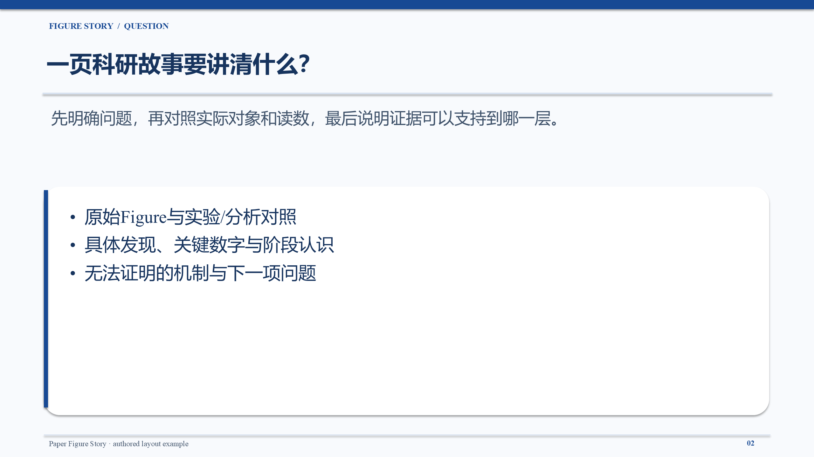

# Paper Figure Story v1.1.0

把论文讲成可核查的科研故事：**为什么研究 → 怎样比较 → 测到了什么 → 结果支持到哪一层**。

这是供Codex使用的科研PPT Skill，核心产物是原始Figure旁的中文短句与可编辑箭头，以及全文多分支科研逻辑框架。支持原创研究、方法/计算论文、资源论文、综述与观点文章；不把所有文章改造成实验流水线。

## 安装与开始

详细步骤见[安装与使用](INSTALL.md)。将包内`paper-figure-story`目录安装到个人Codex skills目录；如已有旧版，先保留旧目录并明确选择新版本。本项目不会自动覆盖已安装Skill。

在Codex中提供主PDF，可补充Supplementary PDF及PPTX模板，然后输入：

> 使用 $paper-figure-story，按balanced模式把这篇论文做成中文学术汇报PPT。保留原图、具体实验/分析和科学边界。

用户不用写JSON。Codex读取论文并整理内部知识模型；Python完成确定性核验、规划和投影。**仅运行PDF索引脚本不会自动理解科学机制。** 缺模型时由Codex接管，不跳过审核。

## 输出与选项

|选项|用途|
|---|---|
|quick|压缩汇报展开，保留关键实验、数字及主图|
|balanced（默认）|完整而精炼的日常学术汇报|
|full|按证据增加方法/限制、必要局部图，不隐式生成全部实验卡|
|主PPT（默认）|封面、问题、开场框架、Figure故事、综合认识；来源JSON/MD另存|
|主PPT＋独立图|另给可编辑的详细科研关系大画布|
|可选深度整理|Methods Inventory、分组/数量/统计审计、详细网络、实验级卡片|

默认16:9学术蓝`#174994`，中文Microsoft YaHei，英文/数字Times New Roman。主稿中的文字、方框和箭头可编辑；论文图像作为图片保留。讲者备注为人类可读内容，完整机器审核独立保存。

输入：可提取文本的PDF；实际取得的补充PDF；PPTX模板。扫描PDF需先做OCR，不能宣传已验证OCR。主稿/关系图输出PPTX、PowerPoint PNG预览，来源与清单输出JSON/Markdown；可选深度卡PPTX和科研逻辑学习手册DOCX/PDF。未提供通用SVG导出器。

详细图与简图共享科研逻辑身份。展示层用“问题、方法、发现、意义”短句，方向关系用清楚的原生箭头；正文不堆砌内部ID和审核代码。辅助共享流程可集中说明，原关系及状态保留在审计中。可选手册先用短句解释研究对象与缺口，再沿真实论证理解设计，实验卡与分支图相邻；完整Methods及字段状态移到附录。复杂图采用较大插页，不能靠缩小全部文字塞入A4。

自定义模板：PFS兼容16:9 PPTX可用新入口`--template`；普通PPTX由成熟native/tagged路径适配，具体限制见[模板说明](INSTALL.md#模板)。不是任意模板的像素级复刻。

## 科学与运行边界

成品PPT默认再经过[Visual Polish](references/visual_polish.md)：实际渲染、字体/布局/原图诊断及定向修复，保留优化前版本。它不重新阅读全文，不新增科学数据；缺失比较或panel明确反馈上游。`run_pfs.py run --no-polish`可关闭，也可独立执行`run_pfs.py polish --pptx 成品.pptx --outdir 新目录`。无编辑计划只检查和规范字体；实际图片须审阅，不能把程序通过当作用户认可。

- Agent先读取全部当前可用科学章节及Methods，整理任务与结果映射，再判断科研关系和制作图；来源定位和程序通过不等于独立同行评审。
- 区分观察、统计关联、作者解释及因果验证；不从构象快照推断连续运动，不从散点/细胞/粒子猜生物学重复。
- 缺失补件/n保持NOT_VERIFIED或PARTIAL；NOT_REPORTED需要明确检查范围。综述被引实验不冒充作者新实验。
- 深度网络和信息卡仍属可选研究整理功能，复杂大图可能需人工调整。没有自动因果发现、跨论文综合或独立假说推理引擎。
- 已验证环境是Windows、Codex桌面提供的Python/Node及Artifact Tool、可用微软雅黑/Times New Roman和本机PowerPoint。其他系统、无字体/无PowerPoint环境不在本版实际视觉验收范围。

运行依赖、三档/模板与轻量测试见[测试说明](TESTING.md)；变更见[CHANGELOG](CHANGELOG.md)，长期方向见[ROADMAP](ROADMAP.md)。[自著布局示例](examples/layout_demo.json)仅展示产品结构，不含第三方论文图像或科研数据。

## 许可

沿用[个人非商业使用许可证](LICENSE)。这是source-available个人使用项目，**不是MIT或OSI开源许可**。商业用途、组织部署与再分发等限制以原许可证为准。第三方论文、Figure和用户材料不属于项目授权，安装包不包含本地论文测试素材。
