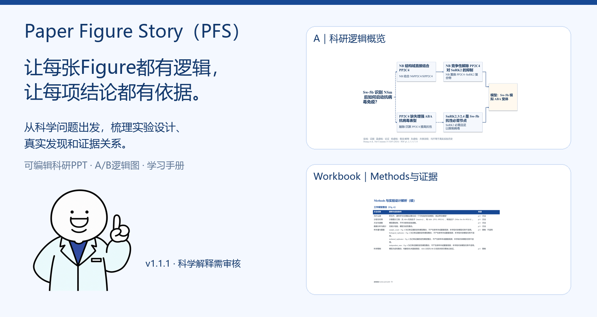
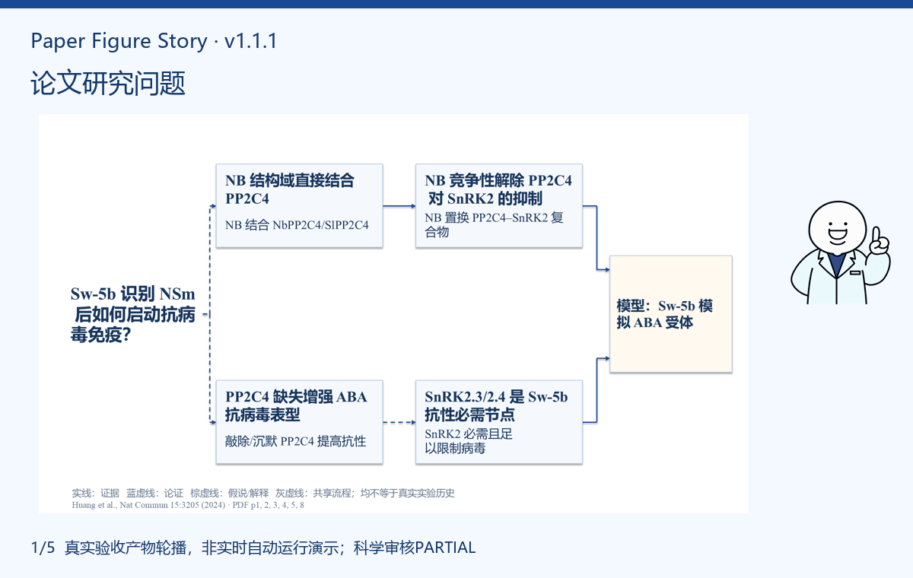
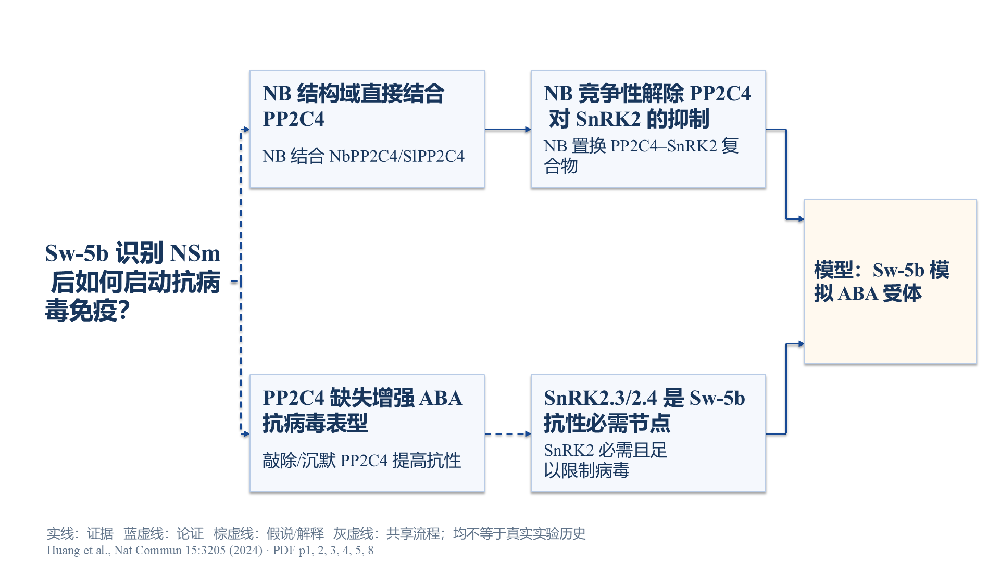
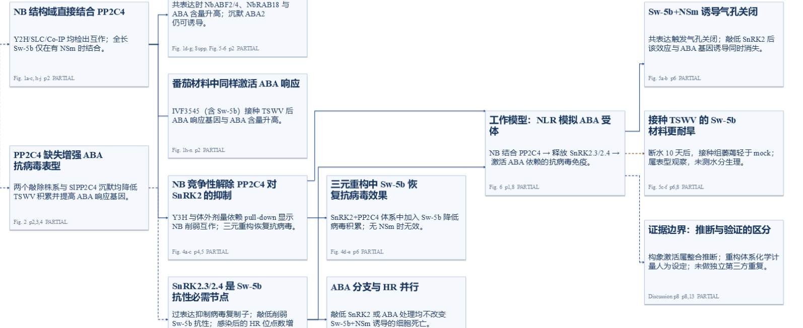
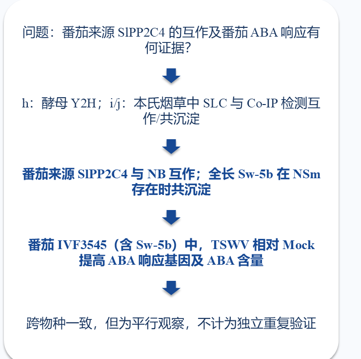
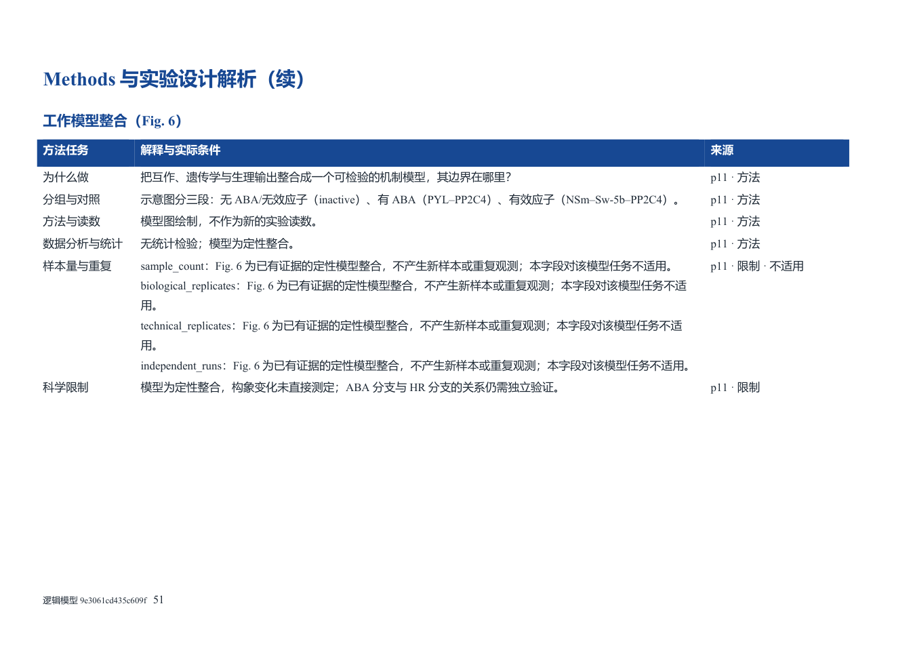

# Paper Figure Story（PFS）

**让每张Figure都有逻辑，让每项结论都有依据。**

从论文的科学问题出发，梳理实验设计、真实发现和证据关系，生成可编辑的科研PPT、逻辑图与学习手册。



## 8秒看看真实成果



[静态替代图](docs/images/v1.1.1/outputs-demo-static.png) · [下载安装v1.1.1](https://github.com/Lu18835713910/paper-figure-story/releases/tag/v1.1.1) · [安装说明](INSTALL.md)

## 从整体到细节：科研逻辑A/B





[打开完整B大画布](docs/images/v1.1.1/logic-b-complete.png)。B包含详细实验、证据与限制，不适合直接缩印A4；主稿采用可读局部视图。

## 逐Figure科研故事与可编辑PPT



真实15页主稿的讲述文字局部，公开演示不含原论文Figure。PPT标题、文字、节点与箭头为原生对象；原论文Figure内部文字仍是图像。

## Research Logic Workbook



最终64页Workbook中的Methods教学表，帮助结合原图学习实验、对照、读数与边界；公开示例未包含第三方原图或内部科学索引。

**PFS让你不只知道论文做了什么，更能看懂它为什么这样做、证据如何连接、结论从哪里来。**

研究可以并行、分叉与汇合，不强制线性Figure顺序。科研解释需要Agent与研究者审核，不是只上传PDF即可保证科学正确的一键PPT生成器。

|模式|用途|
|---|---|
|quick|快速抓住问题、主要任务和发现|
|balanced|兼顾Figure讲述与证据解释|
|full|请求范围内完整产品与严格交付检查；仍需合法科学输入|

## 安装与开始使用

从[正式Release](https://github.com/Lu18835713910/paper-figure-story/releases/tag/v1.1.1)下载`Paper-Figure-Story-v1.1.1.zip`及SHA文件，Windows原生或Python zipfile解压，按[INSTALL](INSTALL.md)配置依赖，再在支持Skills的Agent调用：

> 使用 $paper-figure-story，按balanced模式梳理这篇论文。保留来源、真实实验设计与科学限制，先验证输入和运行环境，再生成产品。

原始科研事实由执行Agent登记；portable已验证，Windows Office仅在验收环境验证，Artifact宿主NOT_TESTED。科学终审PARTIAL、核心贡献审核NOT_ASSESSED。完整维护回归依赖50项私有夹具文件，公开ZIP不能独立复现全部297项。Full复验使用已有模型与输入，不是仅PDF自动建模的证明。

展示案例：Huang et al. (2024), [DOI:10.1038/s41467-024-47364-8](https://doi.org/10.1038/s41467-024-47364-8)。[素材来源与裁切说明](docs/images/v1.1.1/ASSET_PROVENANCE.md) · [已知限制](docs/RC4_ACCEPTED_LIMITATIONS.md) · [版本说明](RELEASE_NOTES_v1.1.1.md)

**Personal Non-Commercial Use License，非MIT/Apache等OSI开源许可。** [LICENSE](LICENSE) · [更新历史](CHANGELOG.md) · [问题反馈](https://github.com/Lu18835713910/paper-figure-story/issues)

---

## 完整功能、使用与历史说明

PFS是面向科研阅读、文献精读和组会汇报的Agent Skill。它帮助研究者理解文章为什么这样研究、实验如何形成证据、不同Figure之间有哪些真实关系，再将这些理解转为可编辑、可追溯的成果。它不只是把论文内容搬进幻灯片。

## v1.1主要更新

|能力|用途与实际边界|
|---|---|
|科研逻辑蒸馏|整理问题、设计、观察、证据、作者解释和未解决问题；不止于摘要|
|非单线程科研逻辑图|按来源呈现递进、并行、分叉、比较、互补和汇合；简图与详细大画布PPTX共享身份|
|逐Figure科研故事|保留原图及panel来源，说明为什么做、怎样比较、实际看到什么和结论边界|
|可编辑学术PPT|标题、正文、结构图与箭头为原生对象；原论文Figure为可替换图片，图内数据不重绘|
|Research Logic Workbook|生成科研逻辑拆解学习手册DOCX，配合实际Word导出PDF；不是另写一篇综述|
|Visual Polish|在科研内容完成后统一视觉、处理连接线与阅读箭头，保留原稿和安全回退|

## 完整研究工作流

当前Agent完整阅读可用正文、Figure legends、Methods与实际取得的补充资料，建立共享科学事实及来源索引；再重建文章的论证关系，生成简要框架、独立详细图、逐Figure汇报及所需学习手册；最后执行Visual Polish与实际预览检查。quick/balanced/full复用同一来源和缓存，不为每档重新读整篇。

**科研理解由使用Skill的Agent执行。** 纯CLI能够索引PDF、验证模型并投影产物；缺少经审核的知识模型时会输出`REVIEWED_KNOWLEDGE_REQUIRED`及Agent交接记录，不会无人辅助证明机制或跳过科学审核。

## 科研逻辑蒸馏

围绕中心科学问题，整理研究背景与缺口、对象及材料、关键对照、方法测量的指标、真实观察、最小可支持结论、作者解释和仍待回答的问题。Methods任务、实验次数、生物学重复、技术重复、细胞/spot/粒子数量分别记录；缺失字段保持未核验状态。

## 非单线程科研逻辑关系图

论文可能有并行支线、独立验证、跨模块比较、共享方法和证据汇合。PFS按实际来源表达这些关系，**不把Fig.1–6机械连成时间线**，也不为美观创造依赖。

这里的“网络”是证据与论证关系图，**不表示使用神经网络模型，也不自动证明因果关系**。简图服务于开场；详细图采用可编辑PPTX大画布及PNG预览。当前没有通用SVG导出器。源于论文、作者解释和汇报组织的联系应分别标注。

## 逐Figure科研故事

每个重要Figure解释：为什么需要这组实验或分析、对象与对照是什么、指标怎样读、panel实际显示什么、支持哪层认识、还有哪些限制。可按真实科学问题拆成多页，不按panel编号机械拆页，也不以一张跨Figure总结代替逐图讲解。

原始Figure是科学证据，图旁短句和箭头负责讲述。所有图像须核对坐标、分组、图例与统计标记；文件存在或SHA正确不等于panel已完成科学审核。

## 可解释、可编辑的学术PPT

默认16:9、学术蓝`#174994`、无机构Logo；中文Microsoft YaHei（微软雅黑），英文及数字Times New Roman。原生标题、文字、框图、连接线可编辑；原始Figure内部文字仍属于栅格图，保持原貌。讲者备注面向科研讲述，机器审计和完整ID另存。

支持用户自定义PPTX模板。新入口支持PFS兼容16:9版式，普通模板可用成熟native/tagged适配；复杂母版/动画的像素级复刻不作承诺。详见[安装与运行](INSTALL.md)。

## Research Logic Workbook

科研逻辑拆解学习手册沿“问题—设计/分析—观察—认识—限制—后续问题”帮助读者学习全文。正文使用短句、对照表、同模型图和必要术语解释；Methods与完整字段可放附录。支持DOCX及实际导出的PDF，图节点在配套PPTX中编辑。它不是普通摘要或论文改写。

## Visual Polish

Visual Polish只决定已确定内容怎样展示得更好：锁定页数/页序、科学内容、Figure/panel分配、节点和边、关系方向/类型、备注、来源与主稿/备份归属，再执行视觉设计、程序编辑和独立QA阶段。

- 科研逻辑连接线可按真实拓扑使用正交折线，不删除或新造关系。
- 普通阅读引导默认使用模块留白中的**原生竖直向下直线箭头**，清楚可见，禁止L/U形回指；并列解释不自动加箭头。
- Agent依据真实PNG制定设计计划；无Agent计划时只做`QA_ONLY`，不能声称完成专业重设计。技术通过不代替用户视觉接受或科学终审。
- 删除的是经明确批准的生成管理标签/纯书目页脚，原文存入audit；实质事实和科学限制不能借美化删掉。失败页可回退。

独立入口及详细合同见[Visual Polish规范](references/visual_polish.md)。

## 三档讲解深度

|模式|目标|适用场景|
|---|---|---|
|quick|压缩展开，保留核心问题、关键结果和限制|快速理解|
|balanced（默认）|平衡逐Figure解释、方法背景与汇报可读性|正式科研汇报、组会|
|full|更充分展开有源Methods、panel、证据边界和学习资料|深度科研精读|

三档区别是深度与展开程度，不是科学准确性；页数由论文与任务决定，不承诺固定页数。

## 安装与快速使用

详细环境、ZIP安装、固定Tag及回退步骤见[INSTALL.md](INSTALL.md)。仓库根目录即Skill目录，安装后应直接看到`paper-figure-story/SKILL.md`，不要多嵌套一层。

当前正式版本为 **`1.1.1`**；该版本已发布Tag与Release。请使用正式Release ZIP安装：

```powershell
# 发布前：从RC压缩包或本地候选目录安装；目标目录须不存在，已有安装请先备份到Skills目录以外。
$skillTarget = Join-Path $env:USERPROFILE '.codex/skills/paper-figure-story'
if (Test-Path -LiteralPath $skillTarget) { throw '目标已存在：请先备份到Skills目录以外。' }
Expand-Archive -LiteralPath .\Paper-Figure-Story-v1.1.1.zip -DestinationPath $env:TEMP\pfs_rc
Copy-Item -Recurse "$env:TEMP\pfs_rc\paper-figure-story" $skillTarget
```

`v1.1.0` 及更早版本的固定 Tag 安装方式保持不变（见[INSTALL.md](INSTALL.md)）。`git clone --branch v1.1.1` 只能在负责人发布授权并创建 Tag 之后使用，现在执行会失败。

在支持本地Skills的Agent中提供论文及可用补件，然后输入：

```text
使用 $paper-figure-story，balanced模式。
先阅读全部当前可用正文、Methods、图注和补件，整理科学问题、实验/论据与证据边界。
按真实关系生成简要科研逻辑图、独立详细逻辑图和逐Figure可编辑中文PPTX，
再生成科研逻辑拆解学习手册DOCX/PDF，并执行不改变科研内容的Visual Polish。
列出实际取得的材料、来源审核状态及待人工核实事项。
```

Python依赖见[requirements.txt](requirements.txt)；PPT导出使用Codex提供的Node/Artifact Tool；实际PNG验收使用本机PowerPoint，手册PDF使用Word。Office、字体及专有运行时不随包分发。其他系统/缺字体或Office环境未通过等价视觉验收。

## 版本选择、升级与回退

|版本|定位|固定入口|
|---|---|---|
|v1.1.1（目标版本，Tag 未创建）|逻辑导航交付合同、完整B拓扑守恒、具备身份核验的发布回归门禁、依赖版本约束|发布授权后由Release提供；当前请用RC压缩包|
|v1.1.0|共享科研证据关系、逐图故事、Workbook和内容锁定Visual Polish|[Release入口](https://github.com/Lu18835713910/paper-figure-story/releases/tag/v1.1.0)|
|v1.0.0|原始逐Figure故事、默认模板与Atera公开案例|[历史Release入口](https://github.com/Lu18835713910/paper-figure-story/releases/tag/v1.0.0)|

Release入口、附件及SHA256须以实际发布结果为准；本地候选不等于已上线，上表 v1.1.1 行不表示该Tag已存在。`main`用于最新版，复现请固定Tag。已有Git安装在工作区干净时可执行`git fetch origin --tags`，再用`git switch --detach v1.1.0`升级或`git switch --detach v1.0.0`回退；不使用强制重置。ZIP安装请保留旧版到Skills目录以外，再安装对应版本。

## 示例与历史

- **[Atera v1.0公开案例](examples/atera/README.md)**及[30页可编辑示例](examples/atera/atera-research-story-demo-30-slides.pptx)保留。该公开副本已移除第三方论文Figure，只展示原生讲述结构，不可作为含原图成品验收。
- [自著布局示例](examples/layout_demo.json)不含第三方论文图像或真实科研数据。
- CNNM4与组织模型综述用于内部真实案例验证；未授权论文原图、未公开稿件、模型缓存和内部日志不随公开版本分发。
- [完整v1.0首页历史](docs/legacy/README_v1.0.md)保留原介绍、示例、安装、版权及边界。v1.0.0为历史补充归档，不改写最初公开日期；历史Tag不随main更新。
- [v1.1宣传素材与文案](https://github.com/Lu18835713910/paper-figure-story/tree/v1.1.0/marketing/v1.1.0)中的科研图形为原创教学示意，不代表真实实验结果或自动生成截图。

## 常见问题与已知限制

**只有PDF就能运行吗？** Agent可以从原文整理内部模型；用户不必手写JSON。纯CLI只做索引/验证/投影，缺模型时交接给Agent。

**补件缺失或科学审核PARTIAL怎么办？** 明确列出缺失范围，保留未核状态；有充分来源的部分可供人工检查。PARTIAL是案例科学边界，不等于软件故障，也不能伪装正式终审。

**所有PPT都自动达到出版级吗？** 不能保证。复杂原图、科学解释和大网络需要人工复核；空间不足需报告，不能以删事实、假连接或缩字掩盖。

**支持所有文献和扫描PDF吗？** 支持原创研究、方法/资源型、综述及观点的相应论证组织，不强求虚构实验。扫描稿需要OCR；本版未验收通用OCR。DOCX/表格可由Agent配套工具阅读，底层统一CLI以PDF入口为准。

**没有Artifact宿主能做什么？** 能完成PDF索引、逻辑A/B/局部图的可移植原生渲染、合稿进已有主稿、Workbook生成与交付核验；**从零生成自适应主稿需要Artifact宿主**，本机不具备该能力。三件套依赖与预检步骤见[宿主依赖与能力边界](docs/HOST_REQUIREMENTS.md)。

**已知限制与交付范围** 逐条列在[已知限制](docs/KNOWN_LIMITATIONS.md)（含8项P2、字号与版面边界、科学审核边界）与[交付包合同](docs/DELIVERY_PACKAGE.md)（交付数量由正式请求与适用性决定；49项仅为历史UniPert案例数量）。

## 科研准确性、版权与许可

AI辅助不能取代研究者的科学审查。来源定位成功、统计关联、结构差异、作者假说及因果验证必须分别表述。未取得或未核实的补充材料不能宣称已读，样本量、重复、统计与结果不能补造。论文论证顺序不冒充实际实验历史。

沿用[Personal Non-Commercial Use License v1.0](LICENSE)：**个人非商业使用｜源码可查看**，*Source-available for personal non-commercial use.* 本项目不是MIT、Apache或OSI意义的开源软件。商业使用、组织部署及再分发等以原许可证为准，不擅自扩大授权。

原论文Figure、数据、商标和用户材料的权利不属于PFS代码许可。公开仓库/安装包不分发内部测试PDF、未获授权原图或私人材料；用户应确认自己材料的使用与分享权限。原创科学家角色由作者提供，清理版去掉了原图红标记及文字，作为项目统一视觉形象；确认版主海报原样保留。[公开材料说明](PUBLICATION_NOTES.md)

## 变更与版本历史

[CHANGELOG](CHANGELOG.md) · [发布说明](RELEASE_NOTES_v1.1.0.md) · [测试与验收边界](TESTING.md) · [已知限制](docs/KNOWN_LIMITATIONS.md) · [交付包合同](docs/DELIVERY_PACKAGE.md) · [宿主依赖](docs/HOST_REQUIREMENTS.md) · [长期方向](ROADMAP.md)


## 正式发布包身份复核

目录名、ZIP名和Git HEAD不能代替实际文件身份。请用本候选的同一工具复核解压后的Skill根目录；输出JSON保存在候选目录外，避免把结果本身再纳入候选。

```text
python -B scripts/candidate_fingerprint.py --root <解压后的paper-figure-story目录>
python -B scripts/candidate_fingerprint.py --zip <候选ZIP> --zip-root paper-figure-story
```

两次输出的`files`、`file_count`及`aggregate_sha256`必须一致。算法沿用rc.2正式清单：根相对POSIX路径排序，每行`路径 空格 文件SHA256`，以UTF-8、LF连接且末行不追加换行，再做SHA-256；仅排除Office的`~$*`锁文件。ZIP校验同时读取CRC与实际内容。当前为正式v1.1.1版本；首次G5盲测失败和科学PARTIAL记录不因工程修复改判。


## 正式v1.1.1能力与验证边界

- portable路径已验证；建议先选择该路径并按INSTALL/宿主文档预检。Windows Office导出已在独立验收机器验证，不代表所有机器均已测试。
- Artifact宿主路径为NOT_TESTED；普通Figure主稿若依赖Artifact，须先验证宿主API与真实创建/导出，不得由portable成功推定宿主可用。
- 本次Full端到端复验复用已有科研模型及相关输入，不是“仅输入PDF即可全自动完成所有科学建模”的独立验证。M1、来源和解释由执行Agent依据论文登记与审核。
- 本案例科学终审PARTIAL，贡献核心审阅NOT_ASSESSED；工程Full不能升级科学审阅。
- Source Data未完整获得；多文档Supplementary一级来源登记存在限制，不能宣称补充材料科学来源完整闭环。
- Logic_B是独立可缩放大画布，不适合直接缩印A4；汇报使用可读局部视图。
- 297项测试经过独立复验，其中依赖的50项私有夹具文件不随公开ZIP分发（不是指只有50项测试）；普通用户不能仅凭公开ZIP复现完整维护回归。可执行公开合成测试，但不能冒充297项门禁。
- 旧版Info-ZIP可能使中文文件名乱码；推荐Windows原生Expand-Archive或Python zipfile解压，解压后核对逐文件SHA。
- 已接受的非阻断排版瑕疵（P8/P15换行、P14句号孤行、索引短续表留白）列入v1.1.2待办，不影响本次原生内容读取；不因此重开排版引擎开发。
- 正式发布身份以v1.1.1 Tag与Release资产SHA为准。
