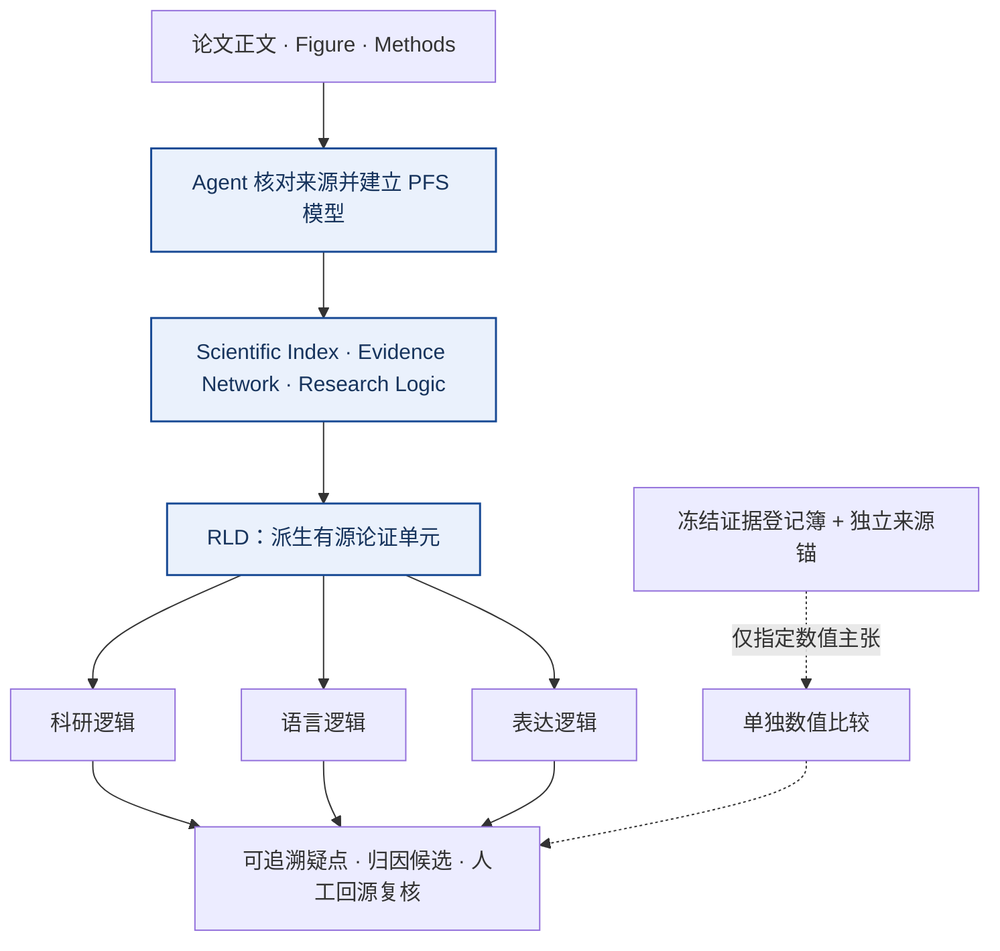

# Paper Figure Story（PFS）

<p align="center"><strong>让每张 Figure 都有逻辑，让每项结论都有依据。</strong></p>
<p align="center">从论文中的科学问题出发，重建实验与证据之间的真实关系，形成可编辑的科研故事；再用 RLD 检查推理、措辞与论据之间的潜在断点。</p>

<p align="center">
  <a href="https://github.com/Lu18835713910/paper-figure-story/releases/tag/v1.2.0"><strong>获取正式版 v1.2.0</strong></a>
  · <a href="INSTALL.md">安装指南</a>
  · <a href="RELEASE_NOTES_v1.2.0.md">版本更新</a>
  · <a href="examples/minimal_rld/README.md">运行 RLD 示例</a>
</p>
<p align="center"><sub>正式发布 · quick / balanced / full · Personal Non-Commercial Use</sub></p>


## 为什么使用 PFS

| 理解科研问题 | 表达证据关系 | 诊断潜在断点 |
|:---|:---|:---|
| 从实验设计、真实观察和关键对照出发，重建并行、分叉与汇合的科学逻辑 | 生成逻辑 A/B、逐 Figure 故事、可编辑 PPT 和 Research Logic Workbook | v1.2.0 新增 RLD，辅助核查科研推理、语言措辞、论证衔接与指定数值主张 |

**PFS 是科研理解和表达工具，RLD 是建立在 PFS 来源工件上的辅助诊断层。** 两者均不替代研究者核对全文、图注、Methods 和证据。

## 真实成果预览

<p align="center">
  <a href="docs/images/v1.1.1/outputs-demo-static.png">
    
  </a>
</p>
<p align="center"><sub>v1.1.1 阶段的真实验收成果，延续用于展示 v1.2.0 的 PFS 基础能力；不是 RLD 自动审稿录像。</sub></p>
<p align="center">
  <a href="docs/images/v1.1.1/outputs-demo-static.png">查看静态总览</a>
  · <a href="docs/images/v1.1.1/ASSET_PROVENANCE.md">图片来源与裁切说明</a>
</p>


## v1.2.0 新增｜Research Logic Diagnostics（RLD）

**从“把论文逻辑讲清楚”，进一步走向“检查论证是否有待核对的缺口”。** RLD 使用同一篇论文已登记的 Scientific Index、Evidence Network 和 Research Logic；不能脱离来源模型，把任意 PDF 自动判定为科学正确或错误。



| 诊断方向 | 实际检查内容 |
|:---|:---|
| **科研逻辑** | 主张与证据是否对应；干预、对照、读出是否足以支持当前推理 |
| **语言逻辑** | 因果、相关、假说、否定和保留措辞是否被正确区分 |
| **表达逻辑** | 论证链、研究分支、限制与结论是否衔接；缺失也可能来自 PFS 重建 |
| **数值来源复核** | 在可信登记簿和外部来源锚支持下，按指标、组别、时期和比较基准检查指定均值主张 |

<details>
<summary><strong>查看 v1.2.0 真实论文回归及其解释边界</strong></summary>

烟草案例从 PFS 工件派生 **15 个论证单元 / 9 条诊断疑点**；另一篇 Cell Reports 案例派生 **29 个论证单元 / 2 条疑点**。烟草预设的 30 条均值主张独立复核为 **14 SUPPORTS / 16 REFUTES**。

这些结果验证了特定输入上的流程和数值比较一致性，**不代表 RLD 准确率、论文错误条数、统计显著性或因果结论**；未登记的主张仍需要 Agent 回查原文。

</details>

[诊断与来源合同](references/rld_diagnosis_contract.md) · [可运行合成示例](examples/minimal_rld/README.md) · [正式发布说明](RELEASE_NOTES_v1.2.0.md)


## PFS 经典能力｜从全篇逻辑到逐图讲述

PFS 不强行将 Fig.1–Fig.N 连成单一时间线，而是根据来源表达研究中真实存在的**并行、递进、比较、共同方法与证据汇合**。以下均为仓库已有的真实成果展示，点击图片可打开大图。

<table>
  <tr>
    <td width="50%" valign="top">
      <a href="docs/images/v1.1.1/logic-a.png"></a>
      <strong>逻辑 A · 全局概览</strong><br>用可读的结构说明中心问题、主要研究分支和核心证据。
    </td>
    <td width="50%" valign="top">
      <a href="docs/images/v1.1.1/logic-b-complete.png"></a>
      <strong>逻辑 B · 详细证据网络</strong><br>展示实验、关系和限制；图片是局部预览，可点开完整原尺寸画布。
    </td>
  </tr>
  <tr>
    <td width="50%" valign="top">
      <a href="docs/images/v1.1.1/figure-story.png"></a>
      <strong>逐 Figure 科研故事</strong><br>说明为什么做、怎样比较、观察到什么及证据边界；PPT 标题、文字和结构为原生可编辑对象。
    </td>
    <td width="50%" valign="top">
      <a href="docs/images/v1.1.1/workbook.png"></a>
      <strong>Research Logic Workbook</strong><br>围绕实验设计、对照与读数整理学习手册；正文与表格可在 DOCX 中编辑。
    </td>
  </tr>
</table>

> **图像与编辑边界：** 原论文 Figure 仍作为图片保留，不重绘数据或伪造 panel；逻辑图的节点在配套 PPTX 中编辑。Workbook 内嵌图是阅读预览，不能替代原尺寸 B 画布。所有公开展示均应遵守原图及素材权利。

### 三档工作深度

| 模式 | 适合场景 |
|:---|:---|
| <code>quick</code> | 快速掌握研究问题、主要分析和发现 |
| <code>balanced</code>（默认） | 兼顾论证过程与逐 Figure 讲述，适用于文献精读和组会 |
| <code>full</code> | 在来源充分时展开详细分析与更严格的交付检查 |

Visual Polish 负责统一版面、连接线和阅读路径，**不会为视觉效果擅自增删科研事实或证据关系**。模式代表展开深度，不是科学可信度等级。

## 下载与快速开始

请从**[正式 v1.2.0 Release](https://github.com/Lu18835713910/paper-figure-story/releases/tag/v1.2.0)**下载：

- [`Paper-Figure-Story-v1.2.0.zip`](https://github.com/Lu18835713910/paper-figure-story/releases/download/v1.2.0/Paper-Figure-Story-v1.2.0.zip)
- [`Paper-Figure-Story-v1.2.0.zip.sha256`](https://github.com/Lu18835713910/paper-figure-story/releases/download/v1.2.0/Paper-Figure-Story-v1.2.0.zip.sha256)

正式 ZIP SHA-256：

```text
14b216a5188b9bf811bd1443a23d049ea301f39ce3edb6eec5d16ad3d1c43a42
```

在 Windows PowerShell 中，下载后于 ZIP 所在目录运行以下示例；**已有同名Skill请先备份到Skills目录之外，不静默覆盖。**

```powershell
$target = Join-Path $env:USERPROFILE '.codex\skills\paper-figure-story'
if (Test-Path -LiteralPath $target) { throw '目标Skill已存在，请先移至Skills目录外备份。' }
Expand-Archive -LiteralPath '.\Paper-Figure-Story-v1.2.0.zip' -DestinationPath '.\pfs_v120'
New-Item -ItemType Directory -Force -Path (Split-Path $target) | Out-Null
Copy-Item -LiteralPath '.\pfs_v120\paper-figure-story' -Destination $target -Recurse
```

安装后应存在 `paper-figure-story/SKILL.md`；如果解压结构不同，以实际 ZIP 内容和[安装文档](INSTALL.md)核对。也可以通过固定 Tag 获取代码：

```bash
git clone --branch v1.2.0 --single-branch https://github.com/Lu18835713910/paper-figure-story.git
```

在支持本地Skills的Agent里提供论文和可用补件，例如：

> 使用 $paper-figure-story，按 balanced 模式梳理这篇论文。先核对全文、Methods、Figure 图注和来源，重建科研问题、真实实验与证据链；生成科研逻辑 A/B、逐 Figure 汇报材料和所需学习手册，保留限制及待人工核查事项。

**需要运行RLD时**，先让Agent完成有来源的PFS三件工件，再使用包内入口（以下文件名为示例）：

```bash
python scripts/rld_units.py --index index.json --network network.json --logic logic.json --out argument_units.json
python scripts/rld_diagnose.py --index index.json --network network.json --logic logic.json --out diagnostics.json
```

第二条命令可以从三件工件直接派生论证单元；Agent仍须回查缺失主张、前提、来源语句、实验对照和科研语境。数值复核须由**独立固定的证据登记簿与外部可信摘要**支持，详细参数及判定规则见[RLD合同](references/rld_diagnosis_contract.md)和[Skill说明](SKILL.md)。这不表示任意PDF里的数字能自动得到可靠结论。

## 验证状态与科学边界

- **科研审核**：RLD 是辅助诊断，不能替代论文作者、领域专家、人工审阅或同行评议。`scientific_accuracy=NOT_ESTIMABLE`。Cell Reports 合规输入仍为 `PARTIAL`，F5疑点保持 `OPEN`，烟草 `AU_L_CL_REG` 的归因仍待人工裁定。部分论证单元缺少直接登记的主张，必须回查原文。
- **数值解释**：14 SUPPORTS / 16 REFUTES 仅对应事先规定的均值比较；不等于统计显著性、论文错误条数或因果结论。来源摘要必须独立保管，不能与修改后的数据一起自证。
- **渲染与宿主**：v1.2.0 发布验收没有重跑完整PPTX渲染；Workbook和投影仍存在既有环境/输入限制。portable逻辑图、主PPT生成、Office导出和Artifact宿主属于不同能力门，成功一种不证明另一种通过。
- **模型来源**：科研事实由执行Agent依据论文登记；只有PDF且缺少经过审核的知识模型时，CLI不会自动证明机制。未获得的补充资料不可宣称已审核。
- **公开资产**：不分发内部科研论文、真实私有模型、canonical登记簿或未获授权的第三方Figure；公开案例及展示资料见[素材来源说明](docs/images/v1.1.1/ASSET_PROVENANCE.md)。

[v1.2.0 发布与验证边界](RELEASE_NOTES_v1.2.0.md) · [历史已知限制记录](docs/KNOWN_LIMITATIONS.md) · [宿主依赖](docs/HOST_REQUIREMENTS.md) · [交付包合同](docs/DELIVERY_PACKAGE.md) · [测试范围](TESTING.md)

## 版本、示例与历史

| 版本 | 主要更新 | 下载 |
|---|---|---|
| **v1.2.0（当前）** | PFS→RLD真实模型交接；科研、语言与表达逻辑候选诊断；可信数值比较 | [正式Release](https://github.com/Lu18835713910/paper-figure-story/releases/tag/v1.2.0) |
| v1.1.1 | 科研逻辑A/B、逐Figure讲述、Workbook、发布校验与既有工具链 | [历史Release](https://github.com/Lu18835713910/paper-figure-story/releases/tag/v1.1.1) |
| v1.1.0 | 共享证据关系及视觉、内容和交付工作流完善 | [历史Release](https://github.com/Lu18835713910/paper-figure-story/releases/tag/v1.1.0) |
| v1.0.0 | 初期逐Figure故事和可编辑学术汇报案例 | [历史Release](https://github.com/Lu18835713910/paper-figure-story/releases/tag/v1.0.0) |

[原生Atera公开示例](examples/atera/README.md) · [PFS v1.0 历史首页](docs/legacy/README_v1.0.md) · [v1.1.1版本说明](RELEASE_NOTES_v1.1.1.md) · [v1.2.0版本说明](RELEASE_NOTES_v1.2.0.md) · [更新历史](CHANGELOG.md)

## 许可证、版权与反馈

本项目采用 **Personal Non-Commercial Use License**：个人非商业使用、源码可查看，**不是 MIT、Apache 或 OSI 意义的开源许可证**。科研论文原图、数据和商标受其各自权利约束。详见[LICENSE](LICENSE)及[公开材料说明](PUBLICATION_NOTES.md)。

[提交问题与反馈](https://github.com/Lu18835713910/paper-figure-story/issues) · [安装与依赖](INSTALL.md) · [返回页首](#paper-figure-storypfs)
